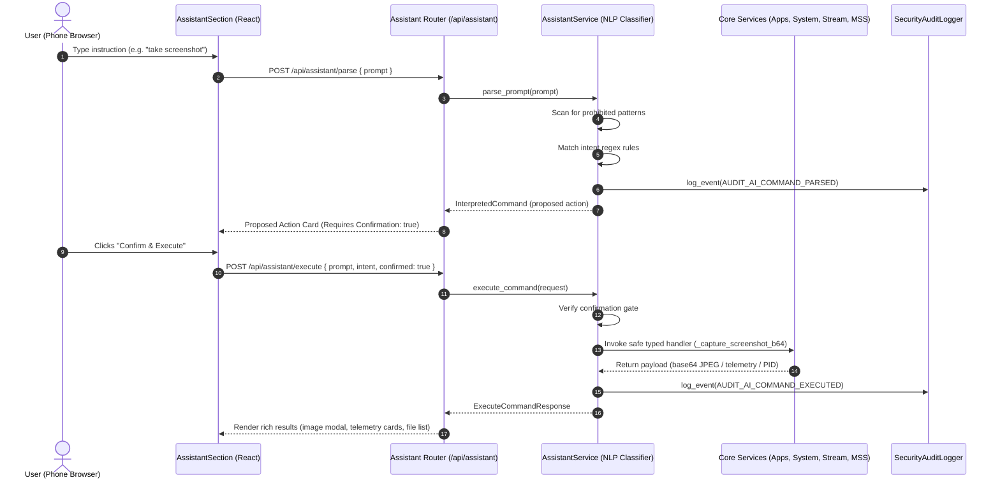

# PocketDesk Stage 8: AI-Assisted Desktop Command Interface

PocketDesk Stage 8 introduces an AI-assisted desktop command interface that translates natural-language instructions from your authenticated mobile phone into safe, strictly-validated desktop actions on your Windows 10/11 laptop.

---

## 1. Core Principles & Threat Model

1. **Zero External AI Dependency:**
   - Requires zero paid API keys, zero OpenAI/Anthropic/Gemini cloud endpoints, and zero external network calls.
   - Operates via a deterministic, rule-based natural language intent classifier built directly into the agent.
   - Guaranteed operational even in offline local-network or air-gapped environments.

2. **Zero Shell Command Execution:**
   - Under no circumstances does the agent evaluate arbitrary shell commands, shell scripts, or language model code generation.
   - `shell=True` is prohibited across the codebase.
   - Instructions are mapped strictly to strongly-typed Python service calls (`app_launcher.launch_app`, `SystemInfoService.get_system_info`, `_search_approved_files`, `stream_manager.stop_stream`, `_capture_screenshot_b64`).

3. **Untrusted Input Handling:**
   - Every user instruction is treated as untrusted input.
   - Raw prompts are scanned against a blacklist of destructive patterns (`rm`, `del`, `format`, `shutdown`, `reboot`, `powershell`, `cmd`, `drop`, `curl`, `wget`).
   - Flagged prompts trigger immediate rejection with security audit alerts.

4. **Two-Stage Confirmation Gate:**
   - High-impact or sensitive operations require secondary user confirmation:
     - **Screen Capture / Screenshot:** Capturing the host desktop requires explicit user confirmation.
     - **Disruptive Applications:** Launching system utilities (Task Manager, Windows Terminal) requires confirmation.
   - The UI presents a proposed action preview card (intent, parameters, risk level) before execution.

5. **Security Audit Logging:**
   - Every parse and execute request generates an audit record logged via `SecurityAuditLogger` with an audit ID.

---

## 2. Command Processing Flow



---

## 3. Supported Intent Catalog

| Intent ID | Action Name | Parameter Requirements | Confirmation Required | Example Prompts |
| :--- | :--- | :--- | :---: | :--- |
| `launch_app` | Launch Application | `app_id` (must match allowlist) | Only if app is disruptive | `"open notepad"`, `"launch calculator"`, `"start edge"` |
| `get_system_status` | Report System Status | None | No | `"check system"`, `"how is my ram"`, `"battery status"`, `"laptop telemetry"` |
| `search_files` | Search Approved Files | `query` (sanitized string), `root_id` (optional) | No | `"find report"`, `"search documents for invoice"`, `"where is my resume"` |
| `control_stream` | Control WebRTC Stream | `action` (`start` or `stop`) | No | `"stop screen share"`, `"start stream"`, `"pause video stream"` |
| `capture_screenshot` | Capture Screenshot | None | **Yes** (Strict Gate) | `"take screenshot"`, `"capture screen"`, `"grab desktop photo"` |
| `show_help` | Display Assistant Help | None | No | `"help"`, `"what can you do"`, `"available commands"`, `"how to use"` |

---

## 4. API Endpoints Reference

### 1. `GET /api/assistant/intents`
Returns the catalog of all supported intents, parameter specifications, confirmation requirements, and example prompts.

- **Authentication:** `Bearer <token>` (Pairing token or remote session token).
- **Response:**
```json
{
  "intents": [
    {
      "intent": "launch_app",
      "name": "Launch Application",
      "description": "Launch an approved allowlisted Windows application",
      "parameters": {"app_id": "string"},
      "requires_confirmation": false,
      "examples": ["open notepad", "launch calculator"]
    }
  ],
  "total": 6,
  "zero_shell_guarantee": true
}
```

### 2. `POST /api/assistant/parse`
Parses a natural-language prompt into an interpreted command structure without executing any actions.

- **Request:**
```json
{
  "prompt": "can you take a screenshot of my desktop please"
}
```
- **Response:**
```json
{
  "raw_prompt": "can you take a screenshot of my desktop please",
  "intent": "capture_screenshot",
  "parameters": {},
  "summary": "Capture a live snapshot of the Windows desktop",
  "is_supported": true,
  "requires_confirmation": true,
  "risk_level": "medium",
  "rejection_reason": null
}
```

### 3. `POST /api/assistant/execute`
Executes an interpreted desktop action after authorization and confirmation checks.

- **Request:**
```json
{
  "prompt": "take a screenshot",
  "intent": "capture_screenshot",
  "parameters": {},
  "confirmed": true
}
```
- **Response:**
```json
{
  "success": true,
  "intent": "capture_screenshot",
  "message": "Desktop screenshot captured successfully.",
  "data": {
    "image_data_uri": "data:image/jpeg;base64,...",
    "width": 1280,
    "height": 720
  },
  "audit_id": "audit_ai_20261021_104500_abc123"
}
```

---

## 5. Security & Safety Testing Checklist

- [x] **Destructive Command Blocking:** Inputting `"delete files"`, `"format c:"`, `"powershell rm"`, or `"shutdown"` results in immediate rejection with `risk_level: "prohibited"`.
- [x] **Shell Injection Prevention:** Metacharacters like `;`, `&&`, `|`, `` ` ``, `$()`, `\x00` do not invoke shells or pass to subprocesses.
- [x] **Unconfirmed Sensitive Action Guard:** Calling `POST /api/assistant/execute` for `capture_screenshot` with `confirmed: false` returns HTTP 400 with a confirmation prompt.
- [x] **Allowlist App Validation:** Prompting `"launch cmd"` or `"open virus.exe"` rejects execution because `cmd` is not in the application allowlist.
- [x] **Approved Directory File Search:** Searching files searches strictly inside approved roots (`Downloads`, `Documents`, `Desktop`, `Pictures`). Path traversal tokens (`..`) are disallowed.
- [x] **Base64 Screenshot Optimization:** Desktop screenshots are downscaled to 720p JPEG to conserve bandwidth and prevent memory bloat.
