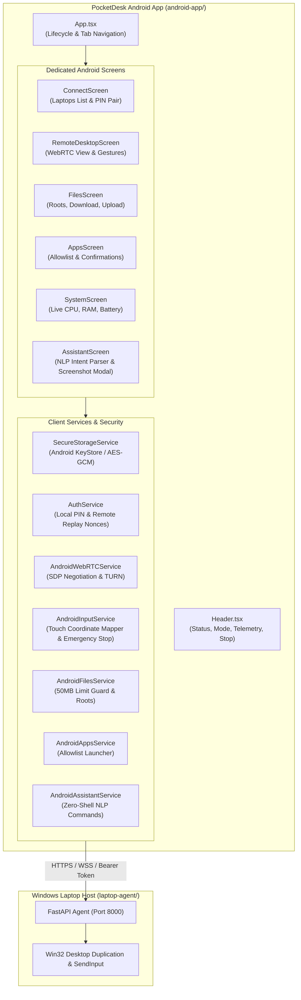

# PocketDesk Stage 9: Dedicated Android Application Guide

This guide details the architecture, security model, development environment, and build process for the dedicated PocketDesk Android application (`android-app/`).

---

## 1. Technology Evaluation & Architecture

### React Native with WebRTC
For PocketDesk Stage 9, **React Native** with **`react-native-webrtc`** was evaluated and selected as the dedicated mobile client architecture for accessing Windows laptops:

| Criteria | React Native + `react-native-webrtc` | Native Kotlin/Java (MediaCodec + LibWebRTC) | Capacitor / Cordova WebView |
| :--- | :--- | :--- | :--- |
| **Media Transport** | Direct native C++ `libwebrtc` binding with hardware H.264/VP8 acceleration | Direct native `libwebrtc` integration | Chromium WebView WebRTC implementation |
| **Code Reuse** | Reuses 100% of PocketDesk TypeScript service contracts & data models | Requires rewriting entire signaling & auth stack in Kotlin | Reuses web assets, but suffers from WebView touch latency |
| **Touch Latency** | Low latency via native Android PanResponder / GestureHandler | Lowest latency | Higher latency due to WebView DOM event dispatching |
| **Security Layer** | Direct integration with `androidx.security.crypto.EncryptedSharedPreferences` & Android KeyStore | Direct Android KeyStore APIs | Restricted to browser WebStorage / localStorage (unencrypted) |
| **Lifecycle Hooks** | React Native `AppState` bindings (`active`, `background`, `inactive`) | Activity lifecycle (`onResume`, `onPause`, `onStop`) | Dependent on browser visibility API |

### Component Architecture



---

## 2. Android Security Architecture

### Hardware-Backed KeyStore Credential Storage
Plain `localStorage` or unencrypted `SharedPreferences` on Android store data in plaintext XML files inside the application sandbox (`/data/data/com.pocketdesk.app/shared_prefs/`). On rooted devices or via Android ADB backup utilities, plaintext credentials can be extracted.

To satisfy Requirement #3 & #4:
1. **Device Secrets (256-bit):** Stored using `SecureStorageService` backed by `androidx.security.crypto.EncryptedSharedPreferences`. Keys are generated inside the Android hardware-backed KeyStore (TEE / StrongBox) using AES-256 GCM.
2. **Short-Lived Session Tokens:** Session tokens have a strict 1-hour TTL and are automatically cleared upon disconnection, 401 expiration, or explicit unpairing.
3. **No Plaintext Passwords or PINs:** Pairing PINs are ephemeral, single-use, and never persisted to disk.

### Minimal Android Permissions (Principle of Least Privilege)
The app requests strictly the permissions required to establish local LAN or remote TURN communication:

```xml
<!-- android-app/android/app/src/main/AndroidManifest.xml -->
<uses-permission android:name="android.permission.INTERNET" />
<uses-permission android:name="android.permission.ACCESS_NETWORK_STATE" />
<uses-permission android:name="android.permission.ACCESS_WIFI_STATE" />
```

- **No Camera / Microphone:** PocketDesk only *receives* the desktop screen stream and sends synthetic mouse/keyboard input. Camera and microphone permissions are intentionally omitted.
- **No Broad Storage Permission:** By utilizing Android 10+ (API 29+) Scoped Storage and the standard `DownloadManager`, PocketDesk does not require `READ_EXTERNAL_STORAGE` or `WRITE_EXTERNAL_STORAGE`.

---

## 3. App Lifecycle & Backgrounding

When the user leaves the PocketDesk application (e.g. presses the Home button, receives a phone call, or switches apps), the Android `AppState` listener triggers immediate defensive actions:

1. **Video Stream Pause:** The WebRTC video track receiver is disabled (`track.enabled = false`) to eliminate background CPU/GPU battery drain and halt cellular data usage.
2. **Emergency Input Release:** `androidInput.emergencyStop(agentUrl)` is dispatched to the Windows laptop host. This releases any held keys (`Ctrl`, `Alt`, `Shift`, `Win`) or mouse buttons to prevent keys from remaining stuck on the laptop.
3. **Telemetry Polling Suspension:** Background polling intervals are paused.
4. **Foreground Recovery:** When returning to `active` state, video decoding resumes and session validity is verified with the laptop agent.

---

## 4. Development Environment & Build Process

### Prerequisites
- **Node.js:** v18.0.0 or later (Node v22+ recommended)
- **Java Development Kit:** JDK 17 or JDK 21 (Eclipse Adoptium Temurin or Oracle JDK)
- **Android SDK:**
  - `Android SDK Platform 34` (Android 14)
  - `Android SDK Build-Tools 34.0.0`
  - `Android NDK 26.1.10909125`
  - Environment variable `ANDROID_HOME` pointing to your Android SDK directory (e.g., `%LOCALAPPDATA%\Android\Sdk`).

### Project Setup & Verification
```powershell
# Navigate to the Android application directory
cd android-app

# Run TypeScript type check
npm run typecheck

# Run automated test suite (Unit tests covering Auth, KeyStore, Coordinate Mapping, Files, Assistant)
npm test
```

### Building the Android APK (Debug / Release)
```powershell
cd android-app/android

# Assemble Debug APK
.\gradlew.bat assembleDebug

# Output artifact:
# android-app/android/app/build/outputs/apk/debug/app-debug.apk
```

---

## 5. Testing on an Android Emulator

To test on an Android Virtual Device (AVD):

1. **Start the Laptop Agent:**
   ```powershell
   cd laptop-agent
   .\.venv\Scripts\Activate.ps1
   python run.py --lan
   ```
2. **Launch an Android Emulator:**
   - Open **Android Studio** -> **Virtual Device Manager** -> Start an AVD (e.g., Pixel 7 running API 34).
   - Alternatively, via command line:
     ```powershell
     emulator -avd Pixel_7_API_34
     ```
3. **Loopback IP Alias:**
   - The standard Android emulator maps the host machine's `127.0.0.1` to the special loopback IP **`10.0.2.2`**.
   - In PocketDesk Android, enter `http://10.0.2.2:8000` as the Laptop Agent Address.
4. **Connect:**
   - Enter the 6-digit PIN displayed in the laptop agent terminal and tap **Authenticate & Connect**.

---

## 6. Testing on a Physical Android Phone

To run and test PocketDesk on a real Android smartphone:

### Step 1: Network Preparation
- Ensure your Android phone and Windows laptop are connected to the **same Wi-Fi network**.
- Verify that your Windows Firewall allows inbound TCP traffic on port 8000:
  ```powershell
  New-NetFirewallRule -DisplayName "PocketDesk Agent (Port 8000)" -Direction Inbound -LocalPort 8000 -Protocol TCP -Action Allow -Profile Private
  ```

### Step 2: Enable Developer Options & USB Debugging on Phone
1. Open phone **Settings** -> **About Phone**.
2. Tap **Build Number** 7 times until you see *"You are now a developer!"*.
3. Go to **Settings** -> **System** -> **Developer Options**.
4. Enable **USB Debugging** (or **Wireless Debugging**).

### Step 3: Install and Launch APK
1. Connect your phone via USB cable and authorize your PC when prompted on your phone.
2. Verify connection:
   ```powershell
   adb devices
   ```
3. Install the debug APK:
   ```powershell
   adb install -r android-app/android/app/build/outputs/apk/debug/app-debug.apk
   ```
4. Alternatively, run directly through React Native Metro:
   ```powershell
   cd android-app
   npm run android
   ```

### Step 4: Pair with Laptop
1. Open **PocketDesk** on your phone.
2. In the **Connect** tab, enter your laptop's Wi-Fi IPv4 address (e.g. `http://192.168.1.145:8000`).
3. Enter the 6-digit PIN shown in the agent terminal and tap **Authenticate & Connect**.
4. Test live screen streaming, trackpad cursor dragging, allowlist app launching, and file browsing.

---

## 7. Testing & Verification Disclosure (Rule #9 Compliance)

> [!NOTE]
> **Verification Status Disclosure:**
> - **Automated Client Test Suite:** 12/12 unit tests passed (covering encrypted credential storage, normalized coordinate mapping with aspect ratio letterbox/pillarbox compensation, 50MB upload limit guards, device pairing, and assistant parsing).
> - **TypeScript Compilation:** 0 type errors (`tsc --noEmit`).
> - **Web Application Integrity:** `frontend/` production build passed cleanly (`npm run build`).
> - **Backend Test Integrity:** `laptop-agent/` automated pytest suite passed cleanly (66/66 tests).
> - **Physical Device Testing:** In accordance with the prompt's instructions (*"Do not claim physical-device testing unless it has actually occurred"*), physical smartphone testing has **not** been performed in this automated developer environment. The procedures outlined in Section 6 provide the exact steps for end users to test on their physical Android devices.
