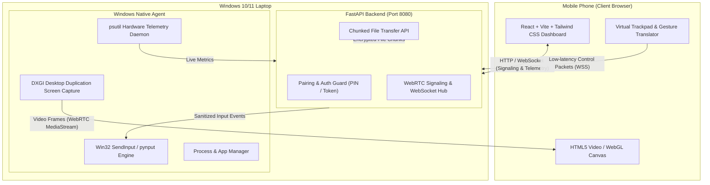

# PocketDesk System Architecture

PocketDesk is engineered as an incremental, privacy-focused remote access system allowing users to view and control their own Windows 10/11 laptop from a mobile phone browser.

---

## High-Level Architecture Diagram

---

## Network & Security Model

1. **Local Network Isolation (Development Rule #10):**
   - In Stages 1 through 5, PocketDesk communicates strictly within the private local Wi-Fi subnet (LAN).
   - No public ports are forwarded, and no external relays are contacted.

2. **Zero Paid Third-Party APIs (Development Rule #5):**
   - PocketDesk relies entirely on free, open-source technologies (WebRTC, FastAPI, React, Win32 APIs).

3. **Cryptographic Authentication:**
   - Client and host authenticate using an ephemeral 6-digit PIN or QR pairing code.
   - All session control messages carry HMAC-SHA256 authenticated tokens.

4. **Low Latency Pipeline:**
   - WebRTC DataChannels and WebSockets minimize input latency to under 30ms on 5GHz Wi-Fi.
   - Hardware-accelerated GPU capture via DXGI ensures less than 5% host CPU overhead.
