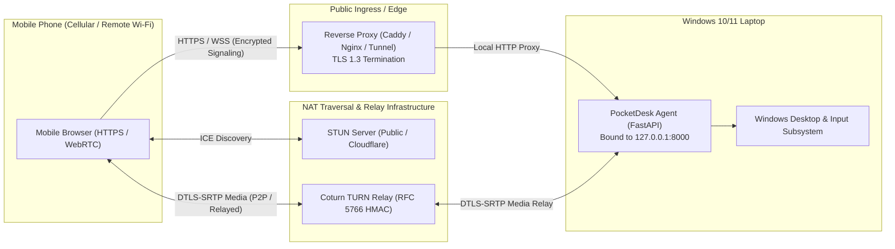

# PocketDesk Remote Internet Deployment Guide (Stage 6)

PocketDesk allows secure remote access to your own Windows 10/11 laptop from a mobile phone across the internet. However, **exposing a remote control agent directly to the public internet without proper isolation and transport protection introduces severe risks.**

This guide details practical, production-grade deployment architectures, step-by-step setup instructions for reverse proxies and TURN relays, cost breakdowns, and self-hosting considerations.

---

## Architecture Overview



### Core Deployment Philosophy
1. **Never bind the PocketDesk agent directly to public `0.0.0.0` or open raw port forwards on your home router.**
2. **Signaling must always traverse TLS 1.3 (HTTPS / WSS).**
3. **WebRTC video and input data channels must use DTLS-SRTP encryption.**
4. **Use dynamic, time-limited TURN relay credentials (RFC 5766 HMAC-SHA1) to prevent unauthorized bandwidth theft.**

---

## Deployment Strategies

Depending on your technical expertise and networking environment, choose between two primary topologies:

| Topology | Complexity | Public IP / Domain Required? | NAT Traversal | Cost |
| :--- | :--- | :--- | :--- | :--- |
| **Option A: Secure Mesh Overlay (Recommended)** | Low | No | Automatic WireGuard P2P | **$0** (Free tier) |
| **Option B: Reverse Proxy + Coturn Relay** | Medium-High | Yes (or Cloudflare Tunnel) | Dynamic STUN + Coturn TURN | **$0 – $5 / month** |

---

## Option A: Secure Mesh Overlay (Tailscale / WireGuard) — Recommended

For personal remote access, a private encrypted mesh overlay (such as **Tailscale**) is the fastest, safest, and most resilient deployment:

### How It Works:
- Both your Windows laptop and mobile phone join your private WireGuard mesh network (Tailnet).
- Tailscale automatically coordinates NAT traversal (using DERP relays when direct UDP fails).
- The laptop agent remains bound to `127.0.0.1` or the private Tailscale IP (e.g. `100.x.y.z`).
- No public ports are opened to the internet.

### Setup Instructions:
1. **Install Tailscale on Windows Laptop:**
   - Download and install Tailscale from [tailscale.com](https://tailscale.com).
   - Sign in and note the laptop's MagicDNS address (e.g., `laptop.tailnet-xyz.ts.net`) or Tailscale IP (`100.x.y.z`).
2. **Install Tailscale on Mobile Phone:**
   - Install the Tailscale app from the iOS App Store or Google Play Store.
   - Sign into the identical account.
3. **Run PocketDesk Agent:**
   - Start the agent on your laptop:
     ```powershell
     cd laptop-agent
     .\.venv\Scripts\Activate.ps1
     python run.py --lan
     ```
4. **Connect from Phone:**
   - On your phone browser, open `http://100.x.y.z:8000` (or `http://laptop.tailnet-xyz.ts.net:8000`).
   - Enter the 6-digit terminal PIN displayed on your laptop.

---

## Option B: Reverse Proxy + Coturn Relay (Public Internet FQDN)

When accessing PocketDesk from standard web browsers without installing VPN/mesh clients, use a hardened reverse proxy with Let's Encrypt TLS and a dedicated Coturn TURN relay.

### Step 1: Reverse Proxy Configuration (Caddy or Nginx)

The reverse proxy terminates HTTPS, validates TLS certificates, handles WebSocket upgrades for WebRTC signaling, and forwards requests to `127.0.0.1:8000`.

#### Caddy Configuration (Simplest, Automatic TLS):
Create a `Caddyfile`:
```caddy
pocketdesk.yourdomain.com {
    # Automatic Let's Encrypt HTTPS
    encode gzip zstd

    # Security Headers
    header {
        Strict-Transport-Security "max-age=31536000; includeSubDomains; preload"
        X-Content-Type-Options "nosniff"
        X-Frame-Options "DENY"
        Referrer-Policy "strict-origin-when-cross-origin"
    }

    # Proxy to PocketDesk FastAPI Agent
    reverse_proxy 127.0.0.1:8000 {
        header_up Host {host}
        header_up X-Real-IP {remote_host}
        header_up X-Forwarded-For {remote_host}
        header_up X-Forwarded-Proto {scheme}
    }
}
```

#### Nginx Configuration:
```nginx
server {
    listen 443 ssl http2;
    server_name pocketdesk.yourdomain.com;

    ssl_certificate /etc/letsencrypt/live/pocketdesk.yourdomain.com/fullchain.pem;
    ssl_certificate_key /etc/letsencrypt/live/pocketdesk.yourdomain.com/privkey.pem;
    ssl_protocols TLSv1.2 TLSv1.3;
    ssl_ciphers HIGH:!aNULL:!MD5;

    # Maximum request size (limit to prevent memory exhaustion)
    client_max_body_size 5M;

    location / {
        proxy_pass http://127.0.0.1:8000;
        proxy_http_version 1.1;
        proxy_set_header Upgrade $http_upgrade;
        proxy_set_header Connection "upgrade";
        proxy_set_header Host $host;
        proxy_set_header X-Real-IP $remote_addr;
        proxy_set_header X-Forwarded-For $proxy_add_x_forwarded_for;
        proxy_set_header X-Forwarded-Proto https;

        proxy_read_timeout 86400s;
        proxy_send_timeout 86400s;
    }
}
```

---

### Step 2: Self-Hosting a Coturn TURN Relay

#### Why Public STUN Is Not Enough:
STUN (Session Traversal Utilities for NAT) allows peers behind simple NATs to discover their public IP and port. However, **Symmetric NATs** (used by virtually all cellular carriers like 4G LTE/5G and corporate Wi-Fi) map different external ports for each destination. Under Symmetric NAT, direct peer-to-peer WebRTC connections **will always fail**. 

A **TURN (Traversal Using Relays around NAT)** server provides an authenticated fallback relay for audio/video packets.

#### Installing Coturn on Ubuntu/Debian Linux VPS:
```bash
sudo apt update && sudo apt install -y coturn
```

#### Configuring `/etc/turnserver.conf`:
```ini
# Coturn Server Configuration for PocketDesk
listening-port=3478
tls-listening-port=5349

# External Public IP of your VPS
external-ip=YOUR_VPS_PUBLIC_IP

# Realm (your domain or hostname)
realm=turn.yourdomain.com

# Time-Limited Ephemeral Credentials (RFC 5766 HMAC-SHA1)
# PocketDesk generates ephemeral tokens matching this shared secret
use-auth-secret
static-auth-secret=CHANGE_THIS_TO_A_CRYPTOGRAPHICALLY_RANDOM_256BIT_SECRET

# Media Relay Port Range
min-port=49152
max-port=65535

# Security hardening: block loopback and private relays
no-loopback-peers
no-multicast-peers
denied-peer-ip=10.0.0.0-10.255.255.255
denied-peer-ip=172.16.0.0-172.31.255.255
denied-peer-ip=192.168.0.0-192.168.255.255

# Logging
log-file=/var/log/turnserver.log
verbose
```

#### Firewall Rules (UFW):
```bash
sudo ufw allow 3478/tcp
sudo ufw allow 3478/udp
sudo ufw allow 5349/tcp
sudo ufw allow 5349/udp
sudo ufw allow 49152:65535/udp
sudo systemctl restart coturn
```

---

### Step 3: Configuring PocketDesk Agent Environment Variables

Configure the laptop agent to use your TURN server by setting the following environment variables (e.g., in a `.env` file in `laptop-agent/` or Windows System Environment):

```env
# Laptop Agent Binding
POCKETDESK_HOST=127.0.0.1
POCKETDESK_PORT=8000

# Public or Reverse Proxy URL
POCKETDESK_PUBLIC_URL=https://pocketdesk.yourdomain.com

# Dynamic TURN Traversal Credentials
POCKETDESK_TURN_URL=turn:turn.yourdomain.com:3478
POCKETDESK_TURN_SECRET=CHANGE_THIS_TO_A_CRYPTOGRAPHICALLY_RANDOM_256BIT_SECRET

# Session & Token Lifetimes (seconds)
POCKETDESK_REMOTE_SESSION_TTL_SECONDS=3600
POCKETDESK_PAIRING_PIN_TTL_SECONDS=300
```

---

## Infrastructure Costs & Bandwidth Considerations

### 1. Cloud VPS Cost for Self-Hosted Coturn
| Provider | Specs | Monthly Cost | Notes |
| :--- | :--- | :--- | :--- |
| **Oracle Cloud** | 1 OCPU, 1 GB RAM (Always Free) | **$0.00** | Generous 10 TB/month free outbound transfer |
| **Hetzner Cloud** | 2 vCPU, 4 GB RAM (CX22) | **~€3.79 / mo (~$4.10)** | 20 TB monthly traffic included |
| **DigitalOcean / Linode** | 1 vCPU, 1 GB RAM Droplet | **$4.00 – $5.00 / mo** | 1 TB monthly traffic included |

### 2. Managed Commercial TURN Services (Alternative to Self-Hosting)
If you prefer not to manage a Linux VPS:
- **Twilio Network Traversal Service:** $0.40 per GB relayed. (Can become expensive for high-bitrate video streaming).
- **Metered.ca:** Free tier offers 50 GB/month; then $0.04/GB.
- **Cloudflare Calls:** WebRTC relay infrastructure with global anycast routing.

### 3. Bandwidth Estimation for Screen Streaming
Desktop screen streaming consumption at various settings:
- **720p @ 15 FPS:** ~1.2 Mbps (~540 MB/hour)
- **720p @ 20 FPS (Default):** ~1.8 Mbps (~810 MB/hour)
- **1080p @ 20 FPS:** ~3.5 Mbps (~1.5 GB/hour)

If you stream for 2 hours per day at 720p, you will consume approximately **50 GB/month** of TURN bandwidth if relaying is required. When direct P2P connectivity succeeds, **0 GB** of TURN bandwidth is used.

---

## Windows UIPI & Permission Constraints

When controlling Windows 10/11:
1. **User Interface Privilege Isolation (UIPI):**
   - Windows security prevents processes running at standard integrity levels from injecting input into processes running at elevated (Administrator) integrity levels.
   - Consequently, the PocketDesk agent (running non-elevated) **cannot** click on UAC ("User Account Control") prompts, the Windows Secure Desktop, or Task Manager if running as Admin.
   - **Do not blindly elevate the PocketDesk agent to Administrator or SYSTEM:** Running remote control daemons as root/SYSTEM creates severe vulnerabilities. Instead, interact only with standard desktop windows.
