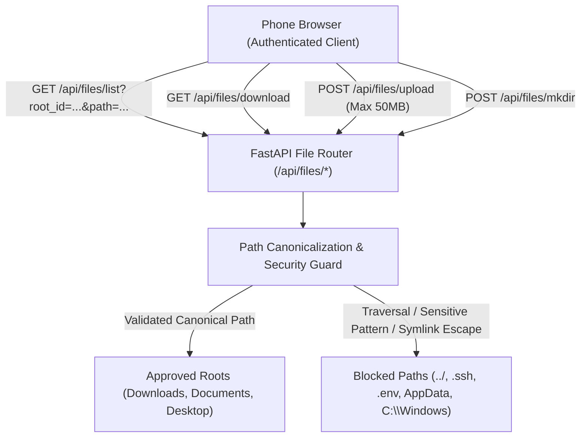
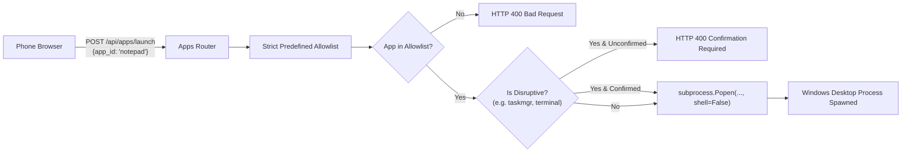

# PocketDesk Stage 7: Restricted File Management & Application Launcher

PocketDesk Stage 7 introduces restricted filesystem management and allowlisted application launching on your Windows 10/11 laptop from an authenticated phone.

This document details the security architecture, path traversal defenses, application allowlist restrictions, API endpoints, and manual testing procedures.

---

## 1. Restricted File Manager Architecture

### Core Security Mitigations

1. **Approved Roots Only (`POCKETDESK_ALLOWED_ROOTS`):**
   - By default, file operations are restricted to standard user directories:
     - `downloads`: `C:\Users\<user>\Downloads`
     - `documents`: `C:\Users\<user>\Documents`
     - `desktop`: `C:\Users\<user>\Desktop`
     - `pictures`: `C:\Users\<user>\Pictures`
   - The user cannot browse arbitrary drives (`C:\`, `D:\`) or system root directories.
   - Custom roots can be configured via `POCKETDESK_ALLOWED_ROOTS="id:Name:Path,..."`.

2. **Canonical Path Traversal Prevention:**
   - Every input path is resolved using `Path.resolve()`.
   - The resolved path must satisfy `candidate.is_relative_to(base_dir)`.
   - Any attempt to use `../`, `..\`, absolute paths (`C:\...`, `/...`, `\\...`), or null bytes (`\x00`) triggers an immediate **HTTP 403 Forbidden** or **HTTP 400 Bad Request**.

3. **Symlink Escape Defense:**
   - The agent resolves `os.path.realpath()` for every path candidate.
   - If a symlink points outside the approved root directory, the agent blocks access with **HTTP 403 Forbidden**.

4. **Sensitive File & Directory Blacklist:**
   - The agent explicitly conceals and refuses to serve:
     - **Credentials:** `.ssh`, `.gnupg`, `.aws`, `.azure`, `.gcloud`, `.kube`, `.docker`
     - **Configuration & Secrets:** `.env`, `id_rsa`, `id_ed25519`, `*.key`, `*.pem`, `*.kdbx`, `*.vault`
     - **Browser Data & App Profiles:** `AppData`, `Local Settings`, cookies, browser profile directories
     - **Windows Internals:** `ntuser.dat*`, `desktop.ini`, `thumbs.db`
     - **Dangerous Executables/Scripts:** `*.bat`, `*.cmd`, `*.vbs`, `*.ps1`, `*.reg`

5. **Upload Size Limits & Partial-File Purging:**
   - Maximum upload size is strictly capped at **50 MB** (`POCKETDESK_MAX_UPLOAD_SIZE_BYTES`).
   - Uploads are streamed in 64 KB chunks. If a client exceeds 50 MB, the transfer is terminated with **HTTP 413 Content Too Large** and the partially written file is immediately purged from disk.

6. **Directory Creation Sanitization:**
   - Folder names are validated against illegal filesystem characters (`\ / : * ? " < > |`).
   - Reserved Windows device names (`CON`, `PRN`, `AUX`, `NUL`, `COM1-9`, `LPT1-9`) are rejected.

---

## 2. Application Launcher Architecture

### Core Security Mitigations

1. **Predefined Allowlist (Zero Arbitrary Command Execution):**
   - The client **never** sends executable paths, commands, or arguments to the laptop agent.
   - The client sends only an immutable `app_id` (e.g. `"notepad"`, `"calc"`, `"explorer"`).
   - The agent maps the `app_id` to fixed, safe executable paths on the Windows host.

2. **No Shell Invocation (`shell=False`):**
   - All processes are spawned using `subprocess.Popen([exe_path], shell=False, start_new_session=True)`.
   - Bypassing the shell eliminates command injection vulnerabilities (e.g. `&`, `|`, `;`, backticks).

3. **Disruptive Action Confirmation:**
   - Applications that can alter system state or inspect background processes (e.g. `taskmgr`, `terminal`) are marked `is_disruptive: true`.
   - The agent requires `confirmed: true` in the request body. Unconfirmed requests are rejected with **HTTP 400 Bad Request**.

4. **Windows UIPI Constraints:**
   - The agent runs under standard user privileges.
   - Processes launched by the agent run at medium integrity level and cannot interact with elevated administrator windows or Windows Secure Desktop (UAC prompts).

---

## 3. Allowlisted Applications Registry

| App ID | Name | Executable | Disruptive? | Purpose |
| :--- | :--- | :--- | :--- | :--- |
| `notepad` | Notepad | `C:\Windows\System32\notepad.exe` | No | Plain text editor |
| `calc` | Calculator | `C:\Windows\System32\calc.exe` | No | Quick calculations |
| `mspaint` | Paint | `C:\Windows\System32\mspaint.exe` | No | Graphics & sketch editor |
| `explorer` | File Explorer | `C:\Windows\explorer.exe` | No | Desktop shell & file explorer |
| `edge` | Microsoft Edge | `C:\Program Files (x86)\Microsoft\Edge\Application\msedge.exe` | No | Web browsing |
| `code` | Visual Studio Code | `%LOCALAPPDATA%\Programs\Microsoft VS Code\Code.exe` | No | Code editing |
| `taskmgr` | Task Manager | `C:\Windows\System32\taskmgr.exe` | **Yes** | Task & resource monitor |
| `terminal` | PowerShell / Terminal | `C:\Windows\System32\WindowsPowerShell\v1.0\powershell.exe` | **Yes** | Interactive shell |

---

## 4. API Endpoints

### File Management (`/api/files`)
| Method | Endpoint | Description | Auth Required |
| :--- | :--- | :--- | :--- |
| `GET` | `/api/files/roots` | List approved root directories | Bearer Token |
| `GET` | `/api/files/list` | List directory contents (`root_id`, `path`) | Bearer Token |
| `GET` | `/api/files/download` | Download an authorized file | Bearer Token |
| `POST` | `/api/files/upload` | Upload file (`root_id`, `path`, `file`) | Bearer Token |
| `POST` | `/api/files/mkdir` | Create folder (`root_id`, `path`, `folder_name`) | Bearer Token |

### Application Launcher (`/api/apps`)
| Method | Endpoint | Description | Auth Required |
| :--- | :--- | :--- | :--- |
| `GET` | `/api/apps/allowlist` | List allowlisted applications | Bearer Token |
| `POST` | `/api/apps/launch` | Launch approved application (`app_id`, `confirmed`) | Bearer Token |

---

## 5. Manual Testing Procedures

### A. Testing File Management
1. **Browse Folders:**
   - In the PocketDesk web client, navigate to the **Files** section.
   - Click between the approved root tabs (`Downloads`, `Documents`, `Desktop`, `Pictures`).
   - Click a folder to enter it; verify that the breadcrumb trail updates and the "Up" folder button navigates back.
2. **Download a File:**
   - Click the download icon next to any document or image.
   - Verify that your mobile browser downloads the file directly.
3. **Upload a File:**
   - Click **Upload** or drag a file into the upload zone.
   - Verify that the percentage progress bar displays (0% to 100%) and that the uploaded file appears in the directory list.
4. **Create a Folder:**
   - Click the **New Folder** icon, enter a folder name (e.g., `Meeting_Docs`), and click **Create**.
   - Verify that the new folder is created in the active directory.

### B. Testing Application Launching
1. **Launch Standard App (e.g. Calculator):**
   - Navigate to the **Apps** section.
   - Click the **Play** button on **Calculator**.
   - Verify that Calculator opens immediately on the Windows host desktop and a green success banner displays with the PID.
2. **Launch Disruptive App with Confirmation (e.g. Task Manager):**
   - Click the **Play** button on **Task Manager**.
   - Verify that a confirmation modal appears warning: *"Potentially disruptive host action"*.
   - Click **Confirm & Launch**.
   - Verify that Task Manager opens on the Windows host desktop.
